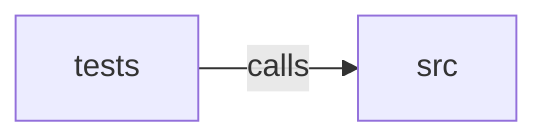

_Generated by CodeAtlas._

## Details

Owns 0 symbols across 1 file(s).

### src

Owns 190 symbols across 17 file(s).

**Related Classes/Methods:** _None_

**Source Files:**

- `crates/core/src/backend.rs`
  - `crates.core.src.backend.BackendEvent`
  - `crates.core.src.backend.BackendEventSink`
  - `crates.core.src.backend.BackendEventSink.new`
  - `crates.core.src.backend.BackendEventSink.send`
  - `crates.core.src.backend.BackendHandle`
  - `crates.core.src.backend.BackendHandle.drop`
  - `crates.core.src.backend.BackendHandle.is_finished`
  - `crates.core.src.backend.BackendHandle.new`
  - `crates.core.src.backend.BackendHandle.stop`
  - `crates.core.src.backend.BackendHandle.stop_and_check_panicked`
  - `crates.core.src.backend.BackendHandle.stop_inner`
  - `crates.core.src.backend.InputBackend`
  - `crates.core.src.backend.tests.is_finished_is_false_while_the_thread_is_alive`
  - `crates.core.src.backend.tests.stop_and_check_panicked_is_false_for_a_clean_exit`
  - `crates.core.src.backend.tests.stop_and_check_panicked_is_true_after_a_panic`
  - `crates.core.src.backend.tests.wait_until_finished`
- `crates/core/src/capture.rs`
  - `crates.core.src.capture.ActiveCapture`
  - `crates.core.src.capture.CaptureGuard`
  - `crates.core.src.capture.CaptureGuard.drop`
  - `crates.core.src.capture.CaptureGuard.kind`
  - `crates.core.src.capture.CaptureGuard.release`
  - `crates.core.src.capture.CaptureId`
  - `crates.core.src.capture.CaptureKind`
  - `crates.core.src.capture.CaptureRegistry`
  - `crates.core.src.capture.CaptureRegistry.acquire`
  - `crates.core.src.capture.CaptureRegistry.is_captured`
  - `crates.core.src.capture.CaptureRegistry.new`
  - `crates.core.src.capture.CaptureRegistry.owner_of`
  - `crates.core.src.capture.CaptureRegistry.pointer_grab_mode`
  - `crates.core.src.capture.CaptureRegistry.reason_of`
  - `crates.core.src.capture.CaptureRegistry.release`
  - `crates.core.src.capture.PointerGrabMode`
- `crates/core/src/coalesce.rs`
  - `crates.core.src.coalesce.CoalesceKey`
  - `crates.core.src.coalesce.Coalescer`
  - `crates.core.src.coalesce.Coalescer.drain_all`
  - `crates.core.src.coalesce.Coalescer.drain_device`
  - `crates.core.src.coalesce.Coalescer.new`
  - `crates.core.src.coalesce.Coalescer.offer`
  - `crates.core.src.coalesce.coalesce_key`
  - `crates.core.src.coalesce.merge`
  - `crates.core.src.coalesce.tests.base`
  - `crates.core.src.coalesce.tests.button`
  - `crates.core.src.coalesce.tests.button_events_are_never_coalesced`
  - `crates.core.src.coalesce.tests.consecutive_motion_is_merged_not_emitted`
  - `crates.core.src.coalesce.tests.different_devices_do_not_coalesce_together`
  - `crates.core.src.coalesce.tests.key`
  - `crates.core.src.coalesce.tests.key_events_are_never_coalesced`
  - `crates.core.src.coalesce.tests.motion`
  - `crates.core.src.coalesce.tests.pending_motion_flushes_before_a_later_button_event`
- `crates/core/src/config.rs`
  - `crates.core.src.config.AccessibilityConfig`
  - `crates.core.src.config.InputConfig`
  - `crates.core.src.config.KeyboardConfig`
  - `crates.core.src.config.KeyboardConfig.default`
  - `crates.core.src.config.PointerConfig`
  - `crates.core.src.config.PointerConfig.default`
  - `crates.core.src.config.TouchConfig`
  - `crates.core.src.config.TouchConfig.default`
- `crates/core/src/device.rs`
  - `crates.core.src.device.BackendMetadata`
  - `crates.core.src.device.BackendMetadata.insert`
  - `crates.core.src.device.ConnectionState`
  - `crates.core.src.device.InputDevice`
  - `crates.core.src.device.InputDevice.supports`
  - `crates.core.src.device.InputDeviceCapabilities`
  - `crates.core.src.device.InputDeviceCapabilities.empty`
  - `crates.core.src.device.InputDeviceCapabilities.keyboard`
  - `crates.core.src.device.InputDeviceCapabilities.mouse`
  - `crates.core.src.device.InputDeviceCapabilities.touchscreen`
  - `crates.core.src.device.InputDeviceClass`
- `crates/core/src/error.rs`
  - `crates.core.src.error.Error`
- `crates/core/src/event.rs`
  - `crates.core.src.event.InputEvent`
  - `crates.core.src.event.InputEvent.is_coalescible`
  - `crates.core.src.event.InputEventPayload`
- `crates/core/src/gamepad.rs`
  - `crates.core.src.gamepad.GamepadAxis`
  - `crates.core.src.gamepad.GamepadButton`
  - `crates.core.src.gamepad.GamepadEvent`
- `crates/core/src/ids.rs`
  - `crates.core.src.ids.InputDeviceId`
  - `crates.core.src.ids.InputDeviceId.default`
  - `crates.core.src.ids.InputDeviceId.fmt`
  - `crates.core.src.ids.InputDeviceId.new`
  - `crates.core.src.ids.SequenceCounter`
  - `crates.core.src.ids.SequenceCounter.new`
  - `crates.core.src.ids.SequenceCounter.next`
  - `crates.core.src.ids.SequenceNumber`
  - `crates.core.src.ids.Timestamp`
  - `crates.core.src.ids.Timestamp.as_nanos`
  - `crates.core.src.ids.Timestamp.now`
- `crates/core/src/keyboard.rs`
  - `crates.core.src.keyboard.KeyAction`
  - `crates.core.src.keyboard.KeyboardEvent`
  - `crates.core.src.keyboard.KeyboardLayout`
  - `crates.core.src.keyboard.KeyboardState`
  - `crates.core.src.keyboard.KeyboardState.is_pressed`
  - `crates.core.src.keyboard.KeyboardState.modifiers`
  - `crates.core.src.keyboard.KeyboardState.new`
  - `crates.core.src.keyboard.KeyboardState.note_down`
  - `crates.core.src.keyboard.KeyboardState.note_up`
  - `crates.core.src.keyboard.KeyboardState.pressed_keys`
  - `crates.core.src.keyboard.KeyboardState.update_modifier`
  - `crates.core.src.keyboard.KeyboardStateTable`
  - `crates.core.src.keyboard.KeyboardStateTable.aggregate`
  - `crates.core.src.keyboard.KeyboardStateTable.new`
  - `crates.core.src.keyboard.KeyboardStateTable.remove`
  - `crates.core.src.keyboard.KeyboardStateTable.state_mut`
  - `crates.core.src.keyboard.LogicalKey`
  - `crates.core.src.keyboard.Modifiers`
  - `crates.core.src.keyboard.PhysicalKey`
  - `crates.core.src.keyboard.UsQwertyLayout`
  - `crates.core.src.keyboard.UsQwertyLayout.map`
  - `crates.core.src.keyboard.UsQwertyLayout.name`
  - `crates.core.src.keyboard.UsQwertyLayout.text_for`
  - `crates.core.src.keyboard.char_key`
  - `crates.core.src.keyboard.tests.aggregate_ors_modifiers_across_keyboards`
  - `crates.core.src.keyboard.tests.caps_lock_toggles_rather_than_tracks_held_state`
  - `crates.core.src.keyboard.tests.holding_ctrl_sets_modifier_and_releasing_clears_it`
  - `crates.core.src.keyboard.tests.note_down_reports_first_transition_only`
  - `crates.core.src.keyboard.tests.removing_a_device_drops_its_state`
  - `crates.core.src.keyboard.tests.us_qwerty_distinguishes_physical_logical_and_text`
- `crates/core/src/pointer.rs`
  - `crates.core.src.pointer.NormalizedPosition`
  - `crates.core.src.pointer.NormalizedPosition.default`
  - `crates.core.src.pointer.PointerButton`
  - `crates.core.src.pointer.PointerEvent`
  - `crates.core.src.pointer.PointerState`
  - `crates.core.src.pointer.PointerState.apply_absolute`
  - `crates.core.src.pointer.PointerState.apply_relative`
  - `crates.core.src.pointer.PointerState.is_pressed`
  - `crates.core.src.pointer.PointerState.new`
  - `crates.core.src.pointer.PointerState.note_button`
  - `crates.core.src.pointer.PointerState.position`
  - `crates.core.src.pointer.PointerStateTable`
  - `crates.core.src.pointer.PointerStateTable.new`
  - `crates.core.src.pointer.PointerStateTable.remove`
  - `crates.core.src.pointer.PointerStateTable.state_mut`
  - `crates.core.src.pointer.ScrollAxis`
- `crates/core/src/registry.rs`
  - `crates.core.src.registry.DeviceRegistry`
  - `crates.core.src.registry.DeviceRegistry.add`
  - `crates.core.src.registry.DeviceRegistry.connected`
  - `crates.core.src.registry.DeviceRegistry.get`
  - `crates.core.src.registry.DeviceRegistry.is_empty`
  - `crates.core.src.registry.DeviceRegistry.len`
  - `crates.core.src.registry.DeviceRegistry.list`
  - `crates.core.src.registry.DeviceRegistry.new`
  - `crates.core.src.registry.DeviceRegistry.remove`
  - `crates.core.src.registry.tests.add_then_get_round_trips`
  - `crates.core.src.registry.tests.device`
  - `crates.core.src.registry.tests.duplicate_registration_is_rejected`
  - `crates.core.src.registry.tests.remove_forgets_the_device`
  - `crates.core.src.registry.tests.removing_unknown_device_errors`
- `crates/core/src/service.rs`
  - `crates.core.src.service.InputService`
  - `crates.core.src.service.InputService.aggregate_modifiers`
  - `crates.core.src.service.InputService.captures`
  - `crates.core.src.service.InputService.config`
  - `crates.core.src.service.InputService.emit`
  - `crates.core.src.service.InputService.flush_coalesced`
  - `crates.core.src.service.InputService.ingest`
  - `crates.core.src.service.InputService.ingest_with_source`
  - `crates.core.src.service.InputService.new`
  - `crates.core.src.service.InputService.registry`
  - `crates.core.src.service.InputService.request_capture`
  - `crates.core.src.service.InputService.set_config`
  - `crates.core.src.service.InputService.set_layout`
  - `crates.core.src.service.InputService.sink`
  - `crates.core.src.service.InputService.start_backend`
  - `crates.core.src.service.InputService.submit_synthetic`
  - `crates.core.src.service.InputService.subscribe`
- `crates/core/src/source.rs`
  - `crates.core.src.source.InputSource`
  - `crates.core.src.source.SyntheticInputGrant`
  - `crates.core.src.source.SyntheticInputGrant.new`
  - `crates.core.src.source.SyntheticInputGrant.with_keyboard`
  - `crates.core.src.source.SyntheticInputGrant.with_pointer`
  - `crates.core.src.source.SyntheticInputGrant.with_touch`
  - `crates.core.src.source.SyntheticOrigin`
- `crates/core/src/tablet.rs`
  - `crates.core.src.tablet.TabletEvent`
  - `crates.core.src.tablet.TabletTool`
- `crates/core/src/touch.rs`
  - `crates.core.src.touch.ContactId`
  - `crates.core.src.touch.TouchContact`
  - `crates.core.src.touch.TouchEvent`
  - `crates.core.src.touch.TouchPhase`
  - `crates.core.src.touch.TouchState`
  - `crates.core.src.touch.TouchState.active_contacts`
  - `crates.core.src.touch.TouchState.apply`
  - `crates.core.src.touch.TouchState.contact_count`
  - `crates.core.src.touch.TouchState.new`
  - `crates.core.src.touch.TouchStateTable`
  - `crates.core.src.touch.TouchStateTable.new`
  - `crates.core.src.touch.TouchStateTable.remove`
  - `crates.core.src.touch.TouchStateTable.state_mut`
  - `crates.core.src.touch.tests.cancel_removes_contact_like_up`
  - `crates.core.src.touch.tests.lifting_one_finger_does_not_affect_others`
  - `crates.core.src.touch.tests.move_updates_position_without_changing_contact_count`
  - `crates.core.src.touch.tests.touch`
  - `crates.core.src.touch.tests.tracks_multiple_simultaneous_contacts`

### tests

Owns 20 symbols across 2 file(s).

**Related Classes/Methods:** _None_

**Source Files:**

- `crates/core/tests/backend_crash_recovery.rs`
  - `crates.core.tests.backend_crash_recovery.OneEventBackend`
  - `crates.core.tests.backend_crash_recovery.OneEventBackend.name`
  - `crates.core.tests.backend_crash_recovery.OneEventBackend.spawn`
  - `crates.core.tests.backend_crash_recovery.PanickingBackend`
  - `crates.core.tests.backend_crash_recovery.PanickingBackend.name`
  - `crates.core.tests.backend_crash_recovery.PanickingBackend.spawn`
  - `crates.core.tests.backend_crash_recovery.a_backend_panic_does_not_take_input_service_down`
  - `crates.core.tests.backend_crash_recovery.a_crashed_backend_can_be_hot_restarted_with_a_fresh_instance`
  - `crates.core.tests.backend_crash_recovery.a_panicking_backend_is_detected_without_blocking`
  - `crates.core.tests.backend_crash_recovery.keyboard`
  - `crates.core.tests.backend_crash_recovery.wait_until_finished`
- `crates/core/tests/service.rs`
  - `crates.core.tests.service.events_from_two_devices_are_each_internally_ordered`
  - `crates.core.tests.service.hotplug_add_registers_device_and_emits_device_added`
  - `crates.core.tests.service.key_press_then_release_produces_down_then_up_in_order`
  - `crates.core.tests.service.keyboard`
  - `crates.core.tests.service.mouse`
  - `crates.core.tests.service.pointer_capture_is_exclusive_and_revocable`
  - `crates.core.tests.service.removing_a_device_clears_its_state_and_emits_device_removed`
  - `crates.core.tests.service.synthetic_device_added_and_removed_are_rejected_because_no_grant_scope_covers_device_management`
  - `crates.core.tests.service.synthetic_input_is_tagged_and_rejected_without_a_grant`
