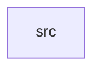

_Generated by CodeAtlas._

## Details

Owns 0 symbols across 1 file(s).

### src

Owns 5 symbols across 2 file(s).

**Related Classes/Methods:** _None_

**Source Files:**

- `crates/linux/src/unsupported.rs`
  - `crates.linux.src.unsupported.LinuxBackend`
  - `crates.linux.src.unsupported.LinuxBackend.default`
  - `crates.linux.src.unsupported.LinuxBackend.name`
  - `crates.linux.src.unsupported.LinuxBackend.new`
  - `crates.linux.src.unsupported.LinuxBackend.spawn`
