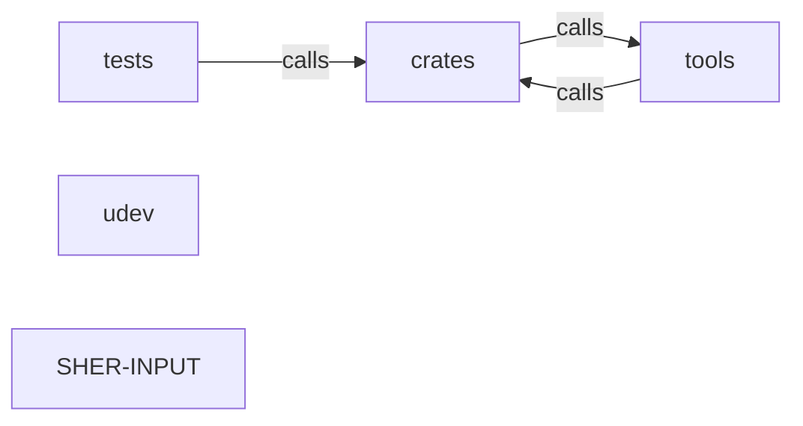

_Generated by CodeAtlas._

## Details

Architecture map of SHER-INPUT.

### crates

Owns 0 symbols across 0 file(s).

**Related Classes/Methods:** _None_

### tests

Owns 0 symbols across 1 file(s).

**Related Classes/Methods:** _None_

### tools

Owns 0 symbols across 0 file(s).

**Related Classes/Methods:** _None_

### udev

Owns 0 symbols across 1 file(s).

**Related Classes/Methods:** _None_

### SHER-INPUT

Owns 0 symbols across 11 file(s).

**Related Classes/Methods:** _None_
