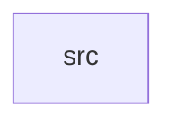

_Generated by CodeAtlas._

## Details

Owns 0 symbols across 1 file(s).

### src

Owns 7 symbols across 1 file(s).

**Related Classes/Methods:** _None_

**Source Files:**

- `tools/sher-input-monitor/src/main.rs`
  - `tools.sher-input-monitor.src.main.demo_script`
  - `tools.sher-input-monitor.src.main.fmt_button`
  - `tools.sher-input-monitor.src.main.fmt_modifiers`
  - `tools.sher-input-monitor.src.main.latency_since`
  - `tools.sher-input-monitor.src.main.main`
  - `tools.sher-input-monitor.src.main.print_event`
  - `tools.sher-input-monitor.src.main.short_id`
