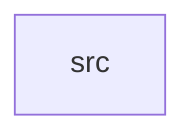

_Generated by CodeAtlas._

## Details

Owns 0 symbols across 1 file(s).

### src

Owns 25 symbols across 4 file(s).

**Related Classes/Methods:** _None_

**Source Files:**

- `crates/test-support/src/backend.rs`
  - `crates.test-support.src.backend.ScriptedBackend`
  - `crates.test-support.src.backend.ScriptedBackend.name`
  - `crates.test-support.src.backend.ScriptedBackend.new`
  - `crates.test-support.src.backend.ScriptedBackend.spawn`
- `crates/test-support/src/controller.rs`
  - `crates.test-support.src.controller.SimulatedController`
  - `crates.test-support.src.controller.SimulatedController.add_keyboard`
  - `crates.test-support.src.controller.SimulatedController.add_mouse`
  - `crates.test-support.src.controller.SimulatedController.add_touchscreen`
  - `crates.test-support.src.controller.SimulatedController.click`
  - `crates.test-support.src.controller.SimulatedController.move_absolute`
  - `crates.test-support.src.controller.SimulatedController.move_relative`
  - `crates.test-support.src.controller.SimulatedController.new`
  - `crates.test-support.src.controller.SimulatedController.press_button`
  - `crates.test-support.src.controller.SimulatedController.press_key`
  - `crates.test-support.src.controller.SimulatedController.release_button`
  - `crates.test-support.src.controller.SimulatedController.release_key`
  - `crates.test-support.src.controller.SimulatedController.scroll`
  - `crates.test-support.src.controller.SimulatedController.tap_key`
  - `crates.test-support.src.controller.SimulatedController.touch_down`
  - `crates.test-support.src.controller.SimulatedController.touch_move`
  - `crates.test-support.src.controller.SimulatedController.touch_up`
  - `crates.test-support.src.controller.SimulatedController.unplug`
- `crates/test-support/src/devices.rs`
  - `crates.test-support.src.devices.keyboard_device`
  - `crates.test-support.src.devices.mouse_device`
  - `crates.test-support.src.devices.touchscreen_device`
