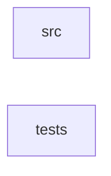

_Generated by CodeAtlas._

## Details

Owns 0 symbols across 1 file(s).

### src

Owns 0 symbols across 1 file(s).

**Related Classes/Methods:** _None_

### tests

Owns 9 symbols across 1 file(s).

**Related Classes/Methods:** _None_

**Source Files:**

- `tests/tests/contract.rs`
  - `tests.tests.contract.Delivery`
  - `tests.tests.contract.MockDisplayRouter`
  - `tests.tests.contract.MockDisplayRouter.route`
  - `tests.tests.contract.focused_surface_receives_its_own_keys_only`
  - `tests.tests.contract.global_shortcut_intercepts_before_focused_surface`
  - `tests.tests.contract.next_payload_event`
  - `tests.tests.contract.pointer_capture_overrides_hit_test_target_and_is_revocable`
  - `tests.tests.contract.unfocused_key_events_are_dropped_not_broadcast_to_every_surface`
  - `tests.tests.contract.unplugging_the_keyboard_mid_session_is_reported_not_fatal`
